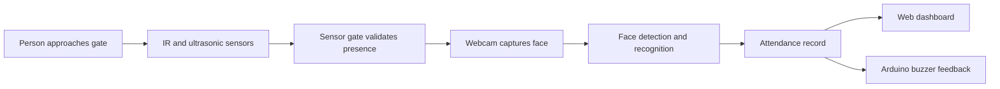

# Smart Multi-Sensor Vision Monitor

## Contactless Attendance Gate

Smart Multi-Sensor Vision Monitor is an IoT and computer-vision attendance concept that identifies a person at an entry point without physical contact.

This GitHub repository contains the project documentation and system overview. The implementation files, trained models, face images, attendance database, and personal records are kept private and are not included here.

The system combines:

- Arduino Uno sensor hardware
- HC-SR04 ultrasonic distance sensing
- FC-51 infrared obstacle detection
- Webcam-based face recognition
- A Flask web dashboard
- SQLite attendance records
- Audible buzzer feedback after a successful check-in

## How It Works



1. The ultrasonic sensor checks whether a person is within the configured distance.
2. The IR sensor confirms that the entry path is occupied.
3. The webcam detects and recognizes the face.
4. Several matching frames are required before a result is accepted.
5. The attendance record and verification snapshot are stored.
6. The web dashboard displays student and attendance information.
7. The Arduino buzzer provides immediate confirmation.

## Main Features

- Dual-sensor presence validation to reduce accidental recognition attempts
- Haar Cascade face detection
- LBPH face recognition designed for CPU-based systems
- Multi-frame recognition confirmation
- Same-day duplicate attendance protection
- Student registration and face enrollment workflow
- Attendance dashboard with present and absent summaries
- Historical attendance records and snapshot evidence
- Arduino buzzer feedback through serial communication

## Hardware

| Component                 | Purpose                             |
| ------------------------- | ----------------------------------- |
| Arduino Uno               | Reads sensors and controls feedback |
| HC-SR04 ultrasonic sensor | Measures the distance to the person |
| FC-51 or HW-201 IR sensor | Detects an obstacle at the gate     |
| Active buzzer             | Signals successful attendance       |
| USB webcam                | Captures the face                   |
| Computer                  | Runs the vision and web application |

### Arduino Pin Layout

| Arduino pin | Connection              |
| ----------- | ----------------------- |
| D2          | IR sensor output        |
| D3          | Active buzzer           |
| D9          | HC-SR04 trigger         |
| D10         | HC-SR04 echo            |
| 5V and GND  | Sensor and buzzer power |

## Software Stack

- Python
- Flask
- OpenCV and OpenCV Contrib
- SQLite
- HTML and Bootstrap-based templates
- Arduino C++ firmware

## Project Workflow

```text
Sensors -> Arduino serial data -> Vision gate -> Face recognition
        -> Flask attendance API -> SQLite database -> Web dashboard
        -> Arduino buzzer confirmation
```

## Demonstration Flow

The complete system is designed to operate in the following sequence:

1. A person approaches the monitored entry point.
2. The ultrasonic sensor checks the person distance.
3. The IR sensor confirms that the entry path is occupied.
4. The vision system detects and compares the face with enrolled identities.
5. Multiple matching frames confirm the recognition result.
6. Attendance is recorded and a verification snapshot is saved privately.
7. The dashboard updates and the buzzer provides confirmation.

## Project Goals

- Demonstrate how IoT sensors and computer vision can work together.
- Reduce false recognition attempts with dual-sensor validation.
- Provide a contactless attendance workflow for controlled environments.
- Keep the design lightweight enough to run on ordinary computer hardware.
- Give administrators a simple way to review attendance activity.

## Expected Benefits

| Area          | Benefit                                                                   |
| ------------- | ------------------------------------------------------------------------- |
| Convenience   | Attendance can be recorded without touching a scanner or signing a sheet. |
| Reliability   | Sensor validation and multi-frame confirmation reduce accidental matches. |
| Feedback      | A buzzer gives immediate confirmation at the entry point.                 |
| Visibility    | A dashboard can summarize current and historical attendance.              |
| Extensibility | The design can be adapted for classrooms, labs, libraries, or offices.    |

## Repository Scope

Only this project overview is published on GitHub. The following items should remain private unless replaced with synthetic demonstration data:

- Source code and firmware
- Face photographs and biometric training data
- Trained recognition models
- Attendance databases and snapshots
- Student names, IDs, contact details, or other personal information

## Future Improvements

- Add stronger liveness detection to reduce spoofing risks.
- Improve recognition performance across different lighting conditions.
- Add role-based administrator access to the dashboard.
- Support configurable sensor thresholds and multiple entry points.
- Add encrypted storage and a configurable data-retention policy.

## Privacy and Data Handling

Face images, trained models, snapshots, attendance databases, and personal student information should be treated as private data. Do not publish real biometric data or personal records in a public repository. Use sample data when preparing a public demonstration.

## Project Status

This project is intended for educational demonstrations and controlled environments. Recognition accuracy depends on lighting, camera placement, enrollment image quality, sensor calibration, and the configured recognition threshold. Face recognition should not be used as the sole basis for high-impact decisions.

## License

This project is licensed under the MIT License.

Copyright (c) 2026 Smart Multi-Sensor Vision Monitor contributors.

Permission is hereby granted, free of charge, to any person obtaining a copy
of this project and associated documentation files, to deal in the project
without restriction, including without limitation the rights to use, copy,
modify, merge, publish, distribute, sublicense, and sell copies of the project,
subject to the following conditions:

The above copyright notice and this permission notice shall be included in all
copies or substantial portions of the project.

THE PROJECT IS PROVIDED "AS IS", WITHOUT WARRANTY OF ANY KIND, EXPRESS OR
IMPLIED, INCLUDING BUT NOT LIMITED TO THE WARRANTIES OF MERCHANTABILITY,
FITNESS FOR A PARTICULAR PURPOSE AND NONINFRINGEMENT. IN NO EVENT SHALL THE
AUTHORS OR COPYRIGHT HOLDERS BE LIABLE FOR ANY CLAIM, DAMAGES OR OTHER
LIABILITY, WHETHER IN AN ACTION OF CONTRACT, TORT OR OTHERWISE, ARISING FROM,
OUT OF OR IN CONNECTION WITH THE PROJECT OR THE USE OR OTHER DEALINGS IN THE
PROJECT.
